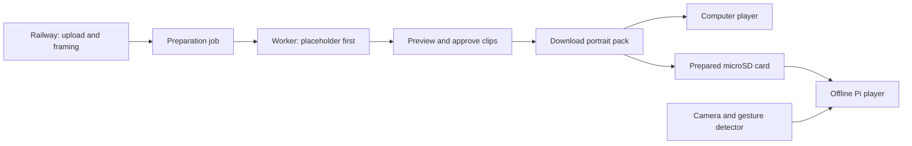
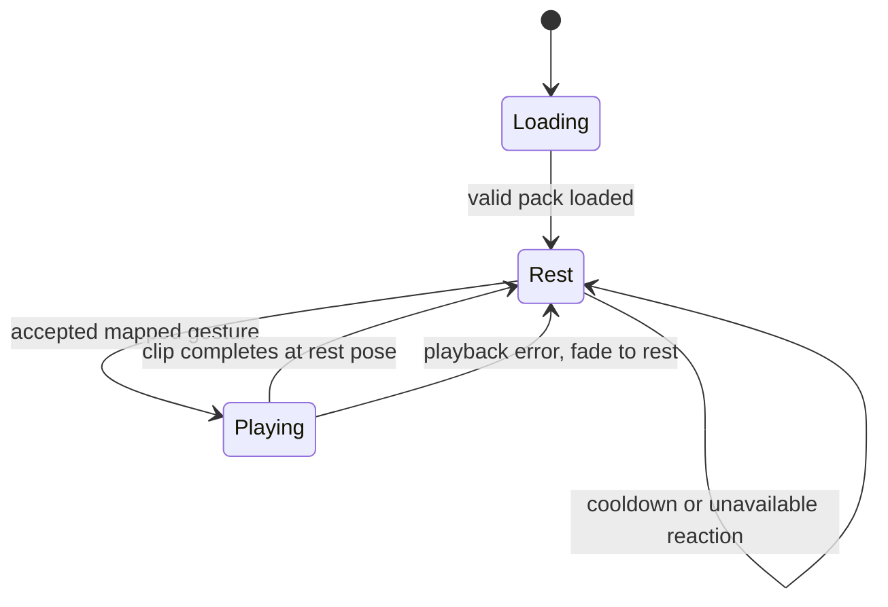

# Spectramotus: photo to interactive frame

> Historical design outline. The implemented browser player, Motus admin, and current deployment workflow are described in [studio-deployment.md](studio-deployment.md). In particular, the shared player is now Chromium/JavaScript, not the native Pygame proposal below.

Draft for discussion — 24 November 2026. This specifies the first end-to-end version; it does not authorize paid generation or deploy anything.

## Product flow

Upload one photo → choose framing and reactions → prepare clips → review them → download a portrait pack → install it on a prepared microSD card → boot the frame.

Confirmed: Railway-hosted authoring interface; offline Pi playback; optional Wi-Fi; computer preview; wave, thumbs-up and additional gestures. Generation providers and the local/cloud split are step 2. Hardware is needed in the US before Sunday, November 29; ZIP, budget and final display size remain open.



## 1. Authoring interface on Railway

One project contains one source photo, one target display profile, a list of requested reactions, clip reviews and an export version.

Screens: upload/framing → preparation status → clip review and simulated gestures → download/install instructions. Keep these as one guided flow, not separate dashboards.

Framing is decided before generation. Produce one canonical `rest.png` at the target canvas size. Every clip must use that exact composition. Preserve the original photo separately. Default to fitting the whole photo; cropping requires a preview and approval. The current 3:4 photo does not fill a 9:16 display without cropping or borders.

Proposed small deployment: one Python FastAPI service serving the UI and API, SQLite on one Railway persistent volume, and a private Railway bucket for source photos, clips and downloads. Single service replica initially. No Redis, separate queue service or fleet system. Jobs are durable database rows; media never relies on ephemeral container storage. Protect authoring with a single-owner login; private files use authorized or expiring download URLs.

Job states: uploaded → queued → preparing → needs review → ready; failed jobs show an actionable error. Show “waiting for local worker” when that worker is offline.

Acceptance: upload, status and approved results survive service restart. A fake preparation job reaches the same review/export screens as a real job.

## 2. Clip preparation: deliberately replaceable

Contract: a job supplies the canonical rest image, requested behaviors, target video profile and spending limit. A worker returns candidate clips, individual status, provenance and any actual cost.

Step 1 uses a fake worker: rest-image clips with obvious demo labels and optional imported existing footage. Never present a different person's sample video as a generated result for a new upload. The current repaired wave can be imported for its matching Plitvice photo.

Step 2 chooses local models, APIs or both together. A local worker can claim jobs through authenticated outbound HTTPS requests; no inbound port on the Mac is needed. Save provider task IDs immediately. Lease jobs and resume polling existing tasks after restart; never blindly resubmit a paid request. Budget approval and actual spending are tracked per job.

Preparation includes trimming, consistent resolution/frame rate/color, return-to-rest repair, encoding and quality checks. Optical flow and expensive blending happen here, not on the Pi.

Every playable reaction follows `rest → action → rest`. The rest endpoints must be visually indistinguishable after encoding. A numeric seam score is useful but cannot replace review of face, hands, camera stability and transition artifacts. A candidate can be rejected or omitted; exporting does not require every requested behavior to succeed.

Acceptance: fake, imported and later generated candidates all produce the same pack format. Only explicitly approved clips ship. Failed or uncertain paid submissions are reconciled before retry.

## 3. Portrait pack and microSD delivery

The content pack is a ZIP, separate from the reusable bootable Pi software image:

```text
portrait.zip
  manifest.json
  rest.png
  clips/wave.mp4
  clips/thumbs_up.mp4
  checksums.sha256
```

Manifest v1 includes schema version, pack ID/version, minimum player version, canvas size, frame rate, rest-image path, clip paths and durations, event-to-clip mappings and cooldowns. Include only available approved reactions. No API keys, raw generation files or camera recordings.

Initial video profile: silent H.264 MP4, yuv420p, constant 24 fps, one canvas size per pack. Confirm decoding performance on the chosen Pi; do not assume H.264 hardware acceleration. PNG rest image is the persistent fallback. Use normalized padding/crop, never stretch faces.

Card flow: flash a reusable Spectramotus OS/player image once, then copy a portrait ZIP to a documented computer-writable import area. The image/provisioning tool must provide that area: ordinary copying to an arbitrary blank card will not make it bootable, and Mac/Windows cannot normally write the Linux root partition. Exact partition layout and installer implementation are an explicit step-1 task, not assumed functionality.

On boot, validate and unpack into staging, then atomically activate a valid pack. Reject unsafe archive paths, missing files, bad checksums or incompatible versions. Retain the previous valid pack. Updates happen while powered down for card removal; optional Wi-Fi transfer is a later convenience.

Acceptance: install on a fresh prepared card; boot without internet; update with another pack; interrupted or corrupt import leaves the previous portrait usable.

## 4. One player for computer and Pi

Use the same Python player package, pack loader and event policy on both platforms. Build on the repository's Pygame/PyAV direction, subject to a Pi playback benchmark. Desktop runs windowed with a debug panel; Pi starts fullscreen automatically. A browser review panel offers quick previews, but the native desktop player is the parity test for the Pi.

The player keeps the rest image visible, decodes ahead into a small bounded buffer, and never blanks the screen while opening a clip. Decode, display and camera inference must not block one another. Do not preload all decoded frames: one short portrait clip can consume hundreds of megabytes.



V1 policy: finish each reaction before accepting another. Ignore gestures during playback and require release/re-arm afterward; no stale queue, no mid-action cuts. Hold rest during cooldown. A later idle clip may also be rest-to-rest, but a still image is enough initially. Brief runtime fades are fallbacks, not a promise to repair arbitrary poses.

Acceptance targets to benchmark: 24 fps playback; no black frame at boundaries; first visible reaction within 300 ms of an accepted event while idle; 100 consecutive reactions and a two-hour playback/sensing run without crashes or sustained frame loss. If sensing is slow, reduce its resolution/rate without reducing display frame rate.

## 5. Gesture input

Camera frames stay on-device. The detector emits timestamped events such as `wave`, `thumbs_up`, `open_palm`, `victory` and `person_present`; the player maps events to available clips. Buttons and keyboard shortcuts emit identical events during placeholder development.

Wave is a movement over time, not simply an open palm. Track hand motion across frames; use confidence, dwell time, cooldown and release-to-rearm to avoid repeated triggers. Start with one active viewer/hand. Add gestures individually after false-trigger testing. Presence can be approximate face/person detection; identity recognition is not required.

Use MediaPipe Tasks as the initial candidate, replacing the legacy `mp.solutions` heuristics. Initial sensing target: 640×480 at 10–15 fps, measured on hardware; tune downward if needed. Absence of a camera leaves playback and manual controls usable.

Acceptance: wave and thumbs-up are distinct, a held hand triggers once, unrelated movement does not repeatedly trigger reactions, and camera failure does not stop the portrait.

## Hardware proposal and ordering gate

Smallest proposed benchmark target: Pi 5 with 2 GB. Preferred first development unit: Pi 5 with 4 GB if the delivered price difference is reasonable. Neither is a measured minimum yet. Current MediaPipe Python documentation explicitly supports Pi 5 on 64-bit Raspberry Pi OS; avoid making a new Pi Zero/Pi 4 purchase depend on unsupported assumptions.

Shopping list: Pi 5; official 27 W USB-C supply with US plug; active cooler; 5-inch Touch Display 2 (7-inch if preferred); compatible display cable and power lead; USB UVC camera for the simplest first setup; 32–64 GB microSD and computer-compatible reader; ventilated stand/enclosure with camera mounting. Verify included cables before ordering. No AI accelerator or SSD required for this proposed prototype.

The official 5-inch and 7-inch Touch Display 2 are 720×1280 portrait. Touch is optional for the experience, useful for setup. A camera module is a compact later option but requires the correct Pi 5 camera cable and mount.

Order only after ZIP-based stock/delivery checks and a concrete total. With a before-Sunday deadline, local pickup or delivery by Saturday is preferable to an unverified Black Friday listing. No purchase made by this plan.

## Build order

1. Agree on this flow, display/framing and initial event mappings; select hardware concurrently.
2. Build the placeholder vertical slice: upload → fake job → review → valid ZIP → native desktop player with gesture buttons. No paid generation.
3. Run the same pack/player on Pi; prove boot, offline operation, storage import, decoding and camera performance.
4. Choose the generation/local-processing combination together; implement it behind the existing job contract. Reuse existing footage to develop packaging and transition repair first.
5. Tune gesture recognition, approve a small useful clip set, and finish enclosure/installation.

Step 1 is complete when one photo can travel through the entire flow, including a real bootable card and Pi playback, with placeholders clearly identified. Cloud generation quality is a separate milestone.

## Existing evidence and limits

The v4 package currently contains CLI/configuration/doctor/model-download scaffolding. The older `interactive_portrait.py` demonstrates gestures and playback but uses a layered PNG workflow and simplistic gesture heuristics. It is reference code, not an already finished portable player. The repaired wave proves a local return-to-photo edit is possible; it does not prove every action can be repaired convincingly.

## References checked 24 November 2026

- [Raspberry Pi 5](https://www.raspberrypi.com/products/raspberry-pi-5/)
- [Touch Display 2](https://www.raspberrypi.com/products/touch-display-2/)
- [MediaPipe Python setup](https://developers.google.com/edge/mediapipe/solutions/setup_python)
- [MediaPipe gesture recognizer](https://developers.google.com/edge/mediapipe/solutions/vision/gesture_recognizer)
- [Railway storage buckets](https://docs.railway.com/storage-buckets)
- [Railway persistent volumes](https://docs.railway.com/volumes)
